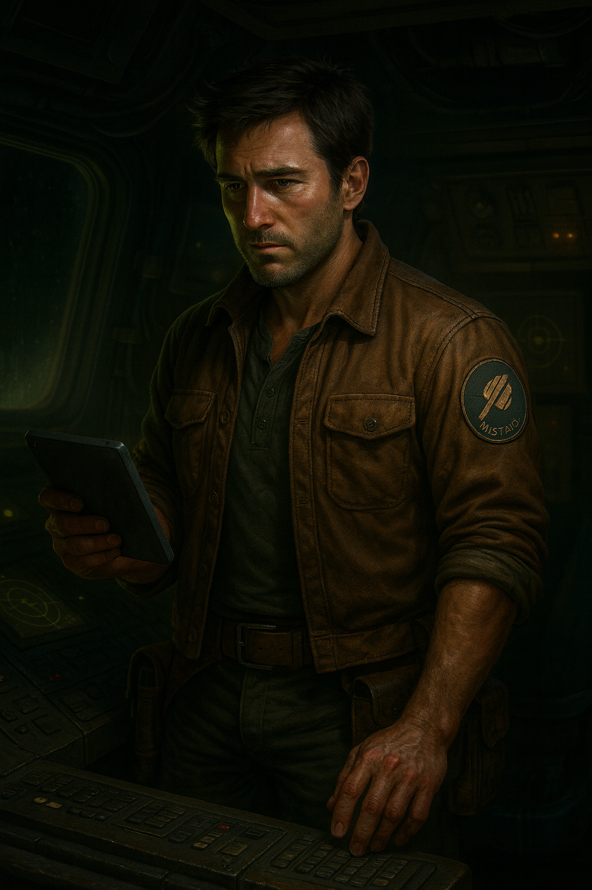
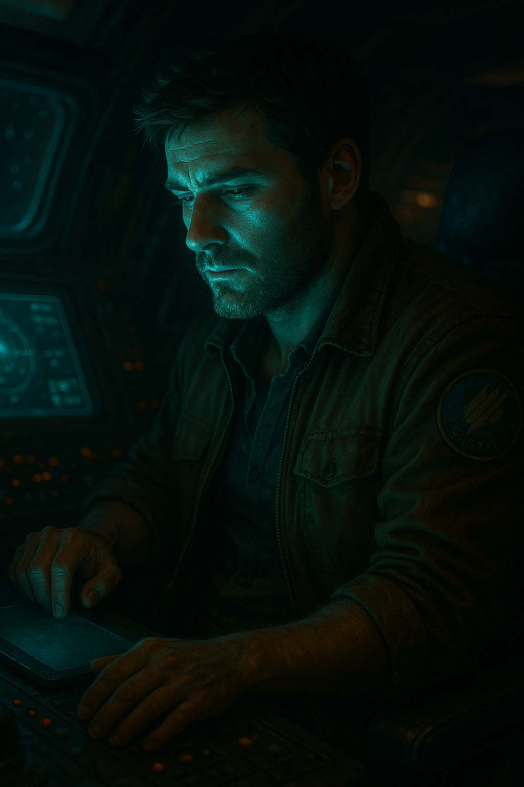

# Tobias Quell

| | |
|---|---|
| **Full name** | Tobias Quell. Goes by Tobias or Quell depending on context. No aliases or callsigns. |
| **Title** | None. **Not a doctor.** **[settled]** |
| **Age** | 42 in 2477. Born **2435**. **[settled]** |
| **Birthplace** | Ravel Prime, a Stratovan Heavyworks shipbuilding world in the Orion Arm |
| **Former occupation** | Senior Systems Engineer, Ravel Industries, FTL Systems & Harmonic Stability (17 years) |
| **Occupation** | Independent deep salvage operator. Unaffiliated, self-directed. |
| **Region** | Outer Perseus Arm, including the Thrennal Expanse and the Trillium Arc |
| **Ship** | [[mistral]] |

## Appearance

A rugged, weathered man in his early 40s with light skin, short brown hair, and stubble. He wears a faded brown work jacket with a Mistral mission patch on the upper sleeve, a muted henley underneath, and durable dark trousers with a tool belt and holstered gear. He's usually holding his data slate. His expression is calm but focused: quiet confidence. His clothes aren't dirty, but show the wear of long hours aboard a ship. Gritty, utilitarian, grounded in the realities of independent space work.

## Background

- **Ravel Prime:** a high-toxicity industrial world in the Orion Arm where most people live in domed arcologies. Citizens are raised in corporate caste tiers and educated early for technical roles. Quell was born into a mid-tier technical enclave and fast-tracked into engineering.
- **Ravel Prime is a Stratovan Heavyworks shipbuilding world [settled]** in the Orion Arm industrial belt, under Nashiro. Its toxic atmosphere comes from generations of heavy industry, and its caste system raises engineers to staff the yards. Ravel Industries was founded there in 2432 by propulsion engineers who broke away, and named after the world.
- Quell grew up a Stratovan caste kid, around the ships he now maintains himself. He followed the breakaways to Ravel, then found it was a different version of the same thing, and left that too.
- Nashiro sits at the top of the chain, one step removed: Quell grew up in the shadow of the people who built Dovetail-9.
- **Ravel Industries, 17 years.** Specialized in navigating unstable FTL corridors: drive system tolerance, resonance prediction, and failure mitigation, especially for ships near marginal or degraded corridors. Regularly deployed to troubleshoot persistent instability in field-deployed vessels. Never involved in creating corridors or in high-level experimental routing.
- **Reputation there:** he solved chaotic resonance failures through quiet analysis and deeply intuitive diagnostics. Effective, but increasingly uncomfortable with the risks Ravel accepted as routine.
- **Leaving:** he took an extended leave of absence and never came back. Ravel didn't contest it. His name was quietly dropped from internal systems, and no formal dismissal was ever issued.
- **Why he left [settled]: a slow realization, not a single incident.** Ravel sells its drives and supports them in the field; customers own their ships and decide where to fly. For 17 years Quell fixed drives Ravel knew were unstable, so customers could fly them back into corridors that might kill them. Every repair kept a dangerous product selling. Eventually he understood he wasn't keeping people safe, he was keeping them flying.
- **What it left him with:** a distrust of systems that report green, and an instant recognition of institutions that treat loss as a cost of business. On Dovetail-9 he finds the same pattern at a far bigger scale.
- **The irony:** he still flies a Ravel drive. He trusts Ravel's engineering, not its judgment.
- **[proposed] Career timeline:** joined Ravel around age 20 (2455), left in 2472, five years of salvage before 2477. That puts him at Ravel when Dovetail-9 vanished in 2467.

### What he knows, and doesn't

He understands how FTL corridors fail and what early signs to look for. He has **no direct experience** with station-wide spacetime anomalies or catastrophic harmonic events. His knowledge makes him sensitive to danger, but unprepared for the scale of what he finds on Dovetail-9.

### Family **[settled]**

- **Alone.** No living family, no partner, nobody waiting for him. Nobody would notice if he didn't come back.
- **An only child. His parents are dead.** They died on Ravel Prime, from the yards or the toxic air, and Stratovan logged it as an ordinary loss and kept the line running. Exact cause and his age at the time are **[open]**.
- His first lesson that companies treat people's deaths as a cost of business, years before Ravel and Dovetail-9 taught it again.
- It fits his life (no base, no identifiers, no keepsakes) and sharpens the ending: the man with no one sends everything he has to strangers.

## Current life

Quell works alone, flying a self-maintained ISRV deep into derelict systems, debris zones, and abandoned infrastructure. His work is unauthorized reclamation, structural retrieval, and onboard diagnostics of lost or condemned vessels, often far beyond corporate oversight.

He avoids major contracts and regulated salvage networks, working from his own scans, leads, and instinct. His knowledge of resonance signatures, corridor decay, and drive failure lets him work where few others will go.

He keeps no permanent base, avoids transmitting identifiers, and trades his recoveries through fringe brokers and silent markets. He's known in certain salvage channels by reputation alone: competent, quiet, never interested in anything beyond the job.

### What he wants **[settled]**

- **He likes to explore and fix things.** That's it. Not money, not escape, not something buried. Salvage lets him do both, alone, on his own terms.
- It's what pulls him to the beacon (somewhere nobody has been in ten years) and onto the station (systems failing, waiting to be understood).
- **The tragedy:** Dovetail-9 is the one thing he can't fix. The crew can't be brought back and the station can't be saved. The fixer's last act is to tell the truth about it.

## Skills

- **FTL drive systems:** harmonic tuning, failure prediction, post-event diagnostics
- **Unstable corridor navigation:** the warning signs, behaviors, and residual patterns of degraded or collapsing corridors
- **Power containment and system stability:** deep-core shielding, resonance dampening, and **catastrophic energy discharge modeling**
- **Structural salvage:** EVA operations, magnetic retrieval, precision hull breach entry, core extraction
- **Vessel diagnostics:** complete shipboard analysis solo, including outdated or corrupted systems
- **Targeted AI use:** relies on high-integrity systems like Navien for calculation-heavy tasks such as flow state, but keeps manual control wherever judgment matters
- **Long-term solo operation:** adapted to deep isolation, minimal communication, and long missions without support

## Habits and quirks

- **Manual first.** Disables or bypasses most automation unless precision demands it. Prefers tactile controls over voice commands, and always runs final checks by hand, even when the system reports green.
- **Private logs, not public reports.** Keeps a personal diagnostic log in tight technical shorthand. Doesn't share it, out of disinterest more than secrecy.
- **Low light.** Dims the Mistral's cabin to simulate salvage-zone conditions. Bright environments feel artificial and overstimulating.
- **No keepsakes, one tool.** Carries a single, heavily worn multi-tool he made himself. The only item he values for its history.
- **No AI small talk.** Disables non-essential AI personality modules. No patience for voice-tone adaptation, chatter protocols, or synthetic empathy.
- **Talks to ships, not people.** Mutters to the Mistral during maintenance, not out of attachment, but because systems make more sense than people.

## Approach to problems **[settled]**

Modeled on Mark Watney in *The Martian*, with Quell's temperament:

- **One problem at a time.** He breaks hopeless situations into small, solvable ones. He can't fix the station; he can fix this door.
- **Works with what's at hand.** Improvises from scrap and salvage. His multi-tool exists for exactly this.
- **Shows his working.** Plans, tests, numbers, results, all in the log.
- **Doesn't panic.** Something goes wrong, he logs it, finds the next step, does it.
- **Gallows humor under pressure,** but terse: one dry line, never a riff. Unlike Watney he isn't chatty or performing for an audience.

> *1615 / DOCKING RING. Clamp 2 jammed. SIGMA says "fault under review". Bypassed via aux panel, 40 min. Clamp 3 next. Then 4.*
> *At this rate I'll own the station by the time I leave.*

**The tragedy it sets up:** a man who can solve anything one piece at a time finally meets the one problem with no next step.

## Log voice **[settled]**

Two registers, kept distinct:

- **Observations: pure shorthand.** Clipped, technical, numbers first. No adjectives he doesn't need.
- **Feelings: short, dry asides.** One line, usually at the end of an observation. Understated, often deflected with humor. He never writes a paragraph about how he feels.

> *0412 / DECK 2 / GALLEY. Thermal drop 3 K, 1.4 s. Condensation on panel. Vents clean. Rechecked twice.*
> *Don't like this room.*

> *0930 / DECK 5 / R&D. Lock still sealed. Override would work. Not using it yet.*
> *Whoever ran this place knew what they were doing. That's the problem.*

- **Entries are tied to places,** timestamped by station time: what he finds in each area, as he finds it.

- Feelings show up more often as the station gets to him, but the shorthand never fully breaks down.
- His later logs, written for whoever receives the dump, keep the same voice. They're addressed to a stranger, but still terse.
- Consistent with his bio: "a personal diagnostic log in tight, technical shorthand".

## Equipment

| Item | Notes |
|---|---|
| **Custom multi-tool** | Designed and machined by Quell during his Ravel years. Compact, rugged, endlessly modifiable; hardened casing, manual override prongs, calibrated for civilian and outdated corporate tech. Maintained obsessively: not sentimental, just essential. The only thing he'd rebuild if lost. |
| [[ravel-protek-3a-eva-suit]] | Modified Ravel-class suit, insignia stripped |
| [[kestral-rs-9v-resonance-scanner]] | Auto-calibration disabled; how he "hears the truth" |
| [[blackline-blds-x]] | His slate (name proposed): logs, diagnostics, salvage records, corridor scans |
| Modified [[navien-ai]] node | Mounted on the Mistral; stripped to core computation, flow state only |
| **Hardcopy engineering docs** | Printed Ravel schematics, pre-collapse corridor maps, unredacted Ravel repair tables. Field-worn and hand-annotated. He doesn't fully trust digital storage alone. |

## On Dovetail-9

- Homes in on the station's distress beacon during an alignment window. The first person to answer it in ten years.
- His Ravel drive is one of the few that can reach the deep Trillium Arc.
- He has to hardlink his slate to force doors and run diagnostics, which means plugging into the AI he'd least want in his systems.
- The longer he stays, the more echoes he notices: exposure disrupts his brain's timing. He can't always trust what he perceives.
- His logs change from private shorthand to testimony meant for strangers.
- He broadcasts the data dump. Then the alignment window closes with him still aboard, and the station slips out of phase, taking him with it. **He does not escape. [settled]**
- **The arc in one line:** the man "never interested in anything beyond the job" ends by giving everything he has to people he'll never meet.

## Reconciliation notes

- The visual reference spelled his name "Quill" and described him as in his early 30s. Canon: **Quell**, **42**.
- The site pitch called him "Dr." Canon: no doctorate.
- His bio listed equipment twice, as two versions. Merged into one list, with named models linked.
- His bio called his slate a "Solance MX-12". Proposed canon name: BLDS-X.
- The original numbered sections skipped section 7. Nothing appears to be missing.

### Images

- The two images here are kept. A third, a stylized illustration, was **left out**: he looks early 30s, which contradicts his age.
- In every image the mission patch text is garbled. It should read **MISTRAL**.
- The images show a sleek tablet. Canon's BLDS-X is a rugged, heavy-cased Blackline slate (see its own image).

## Open

