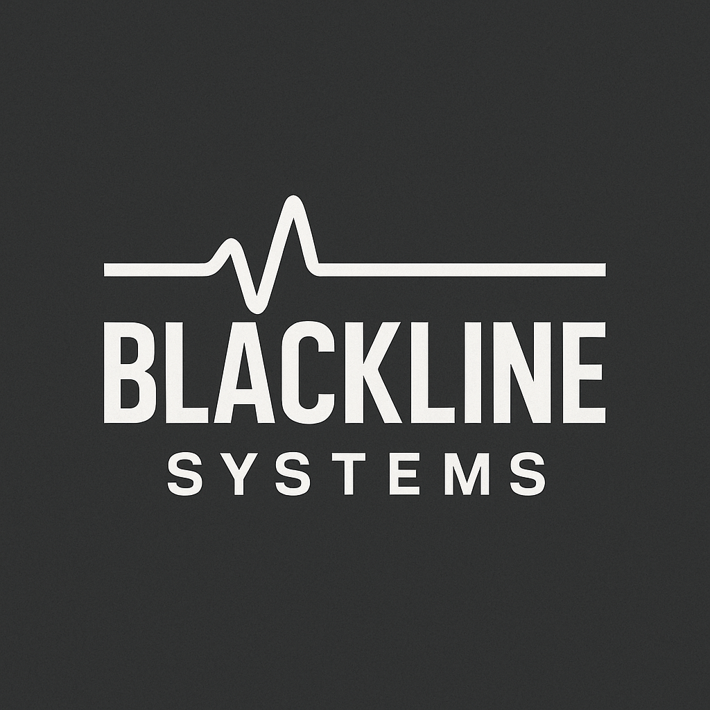

# Blackline Systems

| | |
|---|---|
| **Founded** | 2439 |
| **Headquarters** | Outer Colonies (frontier manufacturing hubs, with select partnerships in core systems) |
| **Industry** | Electronics and survival systems |
| **Tagline** | "Through Unstable Space." |
| **Status** | Independent |

## Overview

Blackline Systems is a frontier electronics company specializing in ruggedized survival gear, personal computing devices, and adaptive communication systems. Unlike the polished corporate tech of Stratovan or Nashiro, Blackline products are deliberately utilitarian: built to work under duress, with heavy casings, modular design, and manual overrides. Its gear is widely used in unstable FTL zones and lawless frontier systems, where reliability matters more than elegance.

## Tone & identity

Rugged, utilitarian, survival-first. Trusted by salvagers, colonists, and frontier operators.

## Key products

- **BLDS (Blackline Data Slate):** ruggedized handheld tablet with glove-use touchscreens, modular comms, manual wireless cutoffs, and extended power cells. Standard models run BLDS-1 through BLDS-4H. A staple among salvagers and explorers.
- **EnviroComm Packs (ECP series):** portable comms and sensor kits for colonists, with atmospheric analysis, signal relays, and power routing nodes for hostile environments.
- **Neural Interface Helmets (NIH series):** rugged EVA neural interfaces for salvage and repair crews. Bulkier than Stratovan designs, but nearly indestructible.
- **Frontier Beacons (FB series):** compact high-output distress beacons that transmit through unstable FTL residue fields.
- **PowerBridge Adapters:** improvised energy-routing systems that let mismatched salvage tech interface safely. Popular in salvage operations and black markets.

## Market position

Blackline sits between industrial specialists like [[duradyne]] and high-tech AI firms like [[stratovan-systems]]. Its reputation for survival-grade resilience makes it indispensable for frontier and salvage work. It is not sleek, elegant, or cutting-edge. It is unbreakable, and that is its strength.

## Relationships

- Longstanding contract with [[stratovan-heavyworks]] for electronics and comms on its ships.

## Connection to Quell

- **[proposed]** Quell carries a **BLDS-X**, a later salvage-spec variant beyond the standard line. Its Universal Data Connector, Protocol Emulation Suite, and Resonance Override Key are the tools behind the site's `spoof` and `override` mechanics, and the slate is the interface the reader sees.

## Reconciliation notes

- The original note named Quell's model as the **BLDS-4H**. Two other notes call it the BLDS-X or the Solance MX-12. The proposal in [[canon]] is BLDS-X, with 4H as the top standard model.
- "Industrial titans like Duradyne" changed to **industrial specialists**, to match Duradyne's own profile.
- Its contract with Stratovan Heavyworks is **electronics and comms**; navigation belongs to Stratovan Systems.

## Open

- Quell's slate model (BLDS-X proposed).
