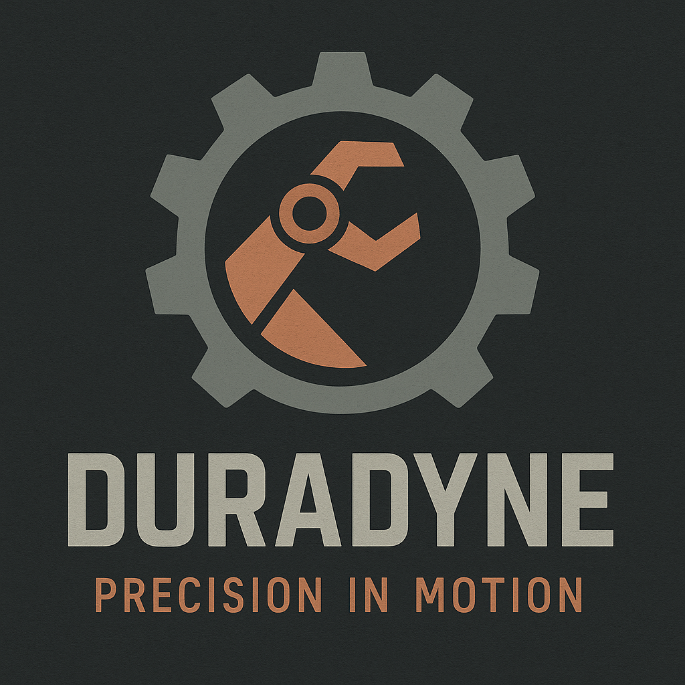

# Duradyne

| | |
|---|---|
| **Founded** | 2442 |
| **Headquarters** | Frontier-sector industrial hub (exact location disputed) |
| **Industry** | Robotics, precision salvage technology |
| **Tagline** | "Precision in Motion." |
| **Status** | Independent |

## Overview

Duradyne carved its place in the industrial landscape as a specialist in high-torque robotic systems. Unlike mass-production robotics firms, it focused on frontier durability: machines that withstand the extreme stresses of salvage, mining, and hazardous recovery in unstable systems.

Its most iconic line is the **Duradyne Retrieval Arm**, an articulated, modular salvage arm that can anchor, cut, and lift wreckage in high-risk environments. These arms became the gold standard for deep-space salvagers, and ship as standard on Stratovan Heavyworks' Mistral-class ISRVs.

Duradyne is a functionalist's brand: less concerned with looks, more with survivability, precision, and performance under duress. Its products are modular, heavily shielded, and often customized by operators in the field, which has earned Duradyne an almost cult following among independent salvagers.

## Tone & reputation

- Industrial, gritty, trusted by frontline crews
- Practical and dependable, if not cutting-edge
- Strongly associated with salvage crews, miners, and deep-space independents

## Notable products

- **Duradyne Retrieval Arm:** high-torque articulated salvage arm, standard on Mistral-class ISRVs. Quell's **DMRA-5** is one, rebuilt from at least three donor bulk-freight units to replace his ship's stock arm.
- **Grav-Anchor Modules:** field-deployable stabilization anchors for salvage operations
- **ServoCore Units:** modular actuator systems for robotics retrofits

## Relationships

- Supplier partnership with [[dynex-industries]]
- Heavy salvage frames on [[stratovan-heavyworks]] ships are built to fit Duradyne robotics

## Reconciliation notes

- The Blackline profile called Duradyne an "industrial titan". Duradyne is a specialist with a cult following, not a titan, so the Blackline file now calls it an industrial specialist.
