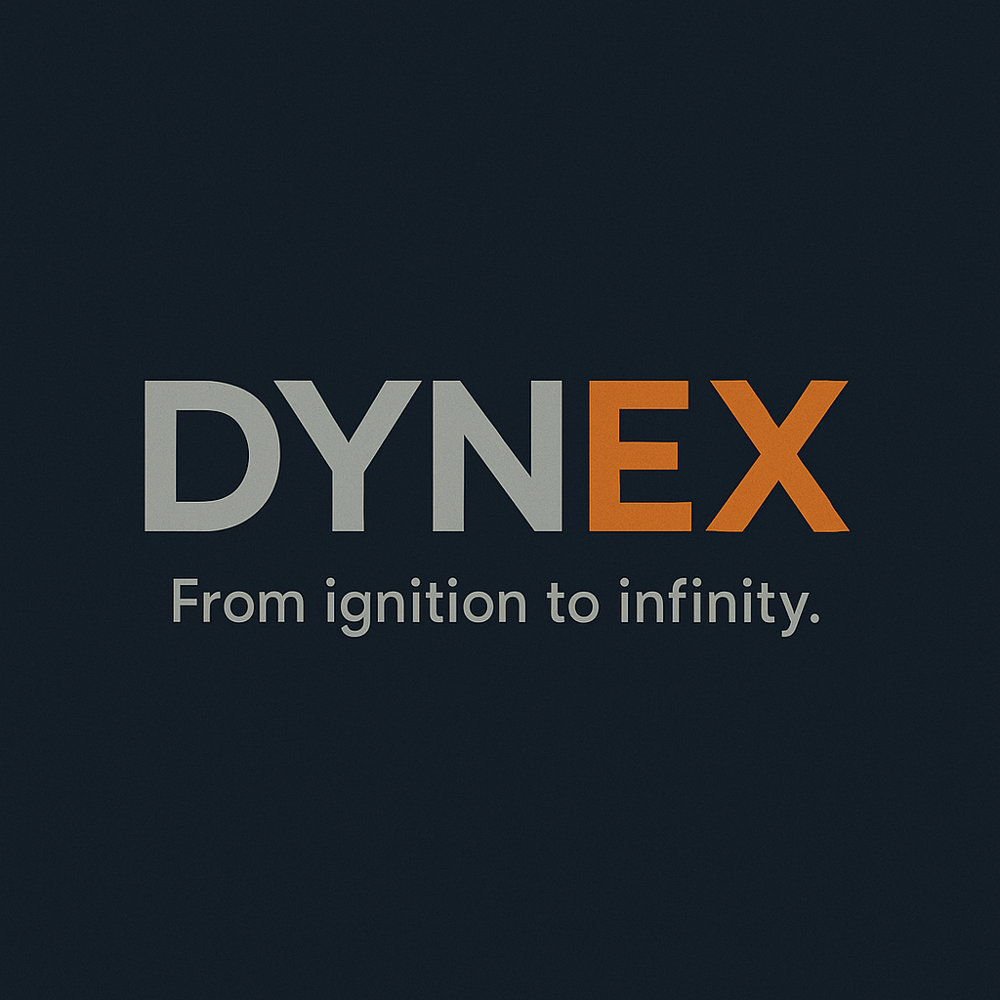

# DYNEX Industries

| | |
|---|---|
| **Founded** | 2386 |
| **Headquarters** | Mid-Rim sector, Perseus Arm trade corridor |
| **Industry** | Advanced energy systems: power cores and singularity containment |
| **Tagline** | "From ignition to infinity." |
| **Saying** | "If it powers, DYNEX has touched it." |
| **Status** | Privately held, no public investment |

## Overview

DYNEX is one of the most trusted names in energy systems, specializing in high-output power cores for deep-space exploration and frontier survival. It rose to prominence by developing compact, stable reactors that endured unstable FTL conditions where other systems failed.

While Kessler-Orion mass-produces engines, DYNEX provides the energy heart that keeps them running. Its **T-Core** series is synonymous with stability under duress, and the **T12** is the standard core on vessels like the Mistral. At the extreme end, DYNEX's experimental **Ignis-Class** singularity containment reactors, like the one aboard Dovetail-9, are infamous for their volatility.

DYNEX walks a line between corporate respectability and a reputation for dangerous ambition. To spacers, its systems are indispensable. To rival corporations, its willingness to court singularity physics makes it reckless.

## Tone & reputation

- Corporate, precise, forward-driven
- Seen as reliable but occasionally overreaching

## DYNEX Heavy Systems (division) **[proposed]**

The division that builds the commercial T-Core line, based at the **Hadros Forgebelt** works, a dense forge cluster near the Galactic Interior.

- **Ethos:** "Trust steel. Trust hands. Trust fuses."
- **Specializations:** fusion and capacitor-based reactor cores, magnetic bottling containment, modular power architecture for ships and stations, analog-controlled no-AI redundancy, emergency field generation for rapid hull isolation.
- **Strengths:** extremely reliable, field-serviceable, modular. **Weaknesses:** oversized, energy-inefficient, not AI-compatible.
- **Users:** deep salvage crews, ghost station engineers, fringe contractors.
- **Security:** high, after multiple IP theft incidents. Some components are banned in core systems due to militarized variants.
- **Field lore:** most cores have mechanical overrides, analog gauges, and literal kill switches. No AI oversight, just fuses and gut instinct.
  - "If it didn't come with a crowbar, it's not a DYNEX."
  - "You don't install a DYNEX core, you house it."

| Product | Description |
|---|---|
| **T12 Core** | Midweight modular fusion unit with analog diagnostics. Used in the Mistral. |
| **MTR-9 Rings** | Magnetic containment stabilizers for core field integrity |
| **VRE-200 Spill Kit** | Vacuum-rated emergency shutdown kit with redundancy coil |
| **VX Capacitor Arrays** | Obsolete capacitor sets found in black-market retrofits |

## Notable products & projects

- **T-Core series:** modular energy cores for ISRV-class ships and heavy freighters
- **T12 Core:** flagship model, widely adopted across salvage and military craft
- **T-CORE X9 Ignis-Class:** experimental Class 5+ singularity containment reactor. Only two built. Unit 001 aboard Dovetail-9; Unit 002 under classified lockdown.
- Longstanding supplier partnerships with [[stratovan-heavyworks]] and [[duradyne]]

## Role in the Dovetail Program

- **Outside contractor** supplying the **X9 Ignis** reactor, under Nashiro oversight.
- DYNEX's own field notes say the X9 is "known to destabilize under prolonged harmonic exposure". They supplied it for a harmonic experiment anyway. That sensitivity triggered the surge in [[the-accident]].
- **Co-wrote the containment-priority protocol** with Nashiro engineers.
- The X9 is the exception to the Heavy Systems division's analog, no-AI promise: built under Nashiro contract and wired directly into SIGMA.

## Reconciliation notes

- **Two Keep notes merged.** "DYNEX" and "Dynex Heavy Systems" were conflicting profiles of the same company. Canon name: **DYNEX Industries**, founded **2386**, Perseus Arm.
- The "3881 Standard Galactic Calendar" founding date is retired.
- The Heavy Systems profile used both "Hadros Beltworks" and "Hadros Forgebelt". Standardized on **Hadros Forgebelt**.
- The original note listed DYNEX among Nashiro's "subsidiaries" in the Experiment summary. Canon: DYNEX is an **independent contractor**.
