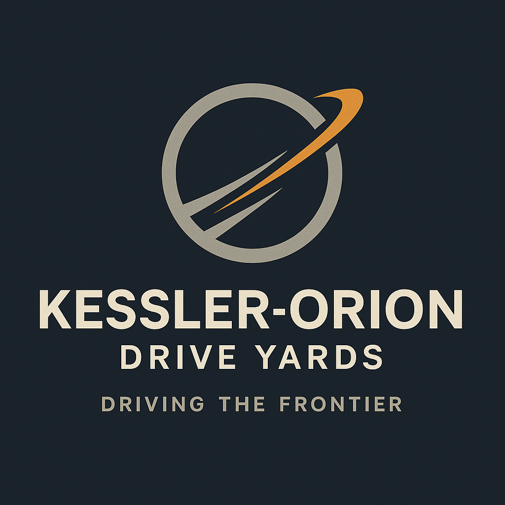

# Kessler-Orion Drive Yards (KOD)

| | |
|---|---|
| **Founded** | 2354 |
| **Headquarters** | Inner Colonies, Orion Arm (exact world classified under trade secrecy) |
| **Industry** | Propulsion megacorp: starship drives, mass-produced slipstream engines |
| **Tagline** | "Driving the Frontier." |
| **Status** | Independent megacorporation |

## Overview

Kessler-Orion Drive Yards emerged in the mid-24th century as the first true propulsion megacorporation, building slipstream drives at industrial scale. Founded thirteen years after Nashiro Dynamics, KOD carved out its niche through practical mass production of reliable FTL drives, so colonial fleets and civilian vessels could move through corridors with minimal risk.

Unlike boutique developers such as [[ravel-industries]], KOD's designs are not elegant or cutting-edge. They are standardized, dependable, and field-serviceable. KOD supplies drives for everything from long-haul freighters to military escorts, and nearly every major colony world has at least one KOD service depot.

That dominance made KOD the default propulsion backbone of colonial expansion, though critics accuse it of stagnation and of resisting innovation in favor of volume and safety certification. Its drives are the workhorses of the galaxy: less glamorous than Ravel's unstable prototypes or Valdez's radical redesigns, but indispensable.

## Tone & reputation

- Stable, industrial, colonialist
- Reliable: "they just work"
- Dismissed as conservative next to fringe innovators

## Notable products & projects

- **Orion Mk-IV Drive:** standardized slipstream engine for ISRV- and corvette-class ships
- **Kessler Core Facilities:** orbital drive yards in more than 40 colony systems
- Strategic contracts with military and civilian governments

## Role in the story

- **None in the Dovetail Program.** KOD is the dependable workhorse, not a villain. **[settled]**
- The Orion Mk-IV is the standard drive for ISRVs, which makes Quell's choice of a Ravel HFSD-3A stand out: he wanted a drive that could survive degraded corridors, not one that "just works".

## Reconciliation notes

- The original site pitch named Kessler-Orion among the megacorps that "turned the frontier into a cage". Canon replaces it with Nashiro and DYNEX.
