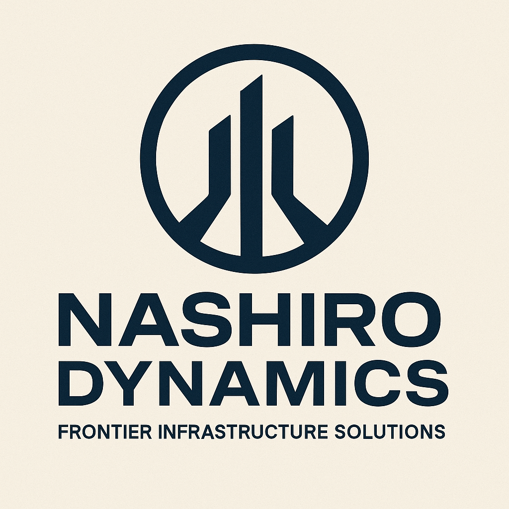

# Nashiro Dynamics

| | |
|---|---|
| **Founded** | 2341 |
| **Headquarters** | Presumed core system, Orion Arm (exact world undisclosed) |
| **Industry** | Interstellar conglomerate: infrastructure, AI governance, propulsion oversight |
| **Tagline** | "Frontier Infrastructure Solutions." |
| **Status** | Parent conglomerate |

Logo variants: navy (primary, above) and [colour](logos/nashiro-dynamics-colour.png).

## Overview

Nashiro Dynamics is among the oldest and most dominant megacorporations in human history. Founded in 2341, it built its empire on frontier infrastructure, financing and supplying the tools of colonization as humanity spread across the galaxy. It grew into a parent conglomerate, absorbing or establishing subsidiaries such as Stratovan Heavyworks and Stratovan Systems, and through them Navien AI.

Nashiro rarely competes in niche product markets directly. It exerts control through governance systems, licensing regimes, and acquisitions. Where other corporations engineer ships or drives, Nashiro sets the terms by which they can operate. Its presence in frontier development is subtle but absolute: contracts, supply lines, and station infrastructure often bear Nashiro's mark whether its name is visible or not.

Its most ambitious and controversial project was deploying the SIGMA AI system aboard the Dovetail stations, which places Nashiro at the center of the chain of events that caused Dovetail-9's disappearance.

## Tone & reputation

- Aloof, authoritarian, corporate overlord
- Present everywhere in infrastructure, rarely visible in person
- Feared more for policy power than technical competition

## Subsidiaries & projects

- **[[stratovan-heavyworks]]:** ISRV-class shipbuilding (est. 2412)
- **[[stratovan-systems]]:** AI frameworks and navigation systems (est. 2437)
- **Navien AI:** FTL navigation platform, a Stratovan Systems product (2460)
- **SIGMA:** Synthetic Intelligence for Governance, Monitoring, and Adaptation. Nashiro's station-governance AI.
- Corridor oversight contracts in both the Orion and Perseus Arms

## Role in the Dovetail Program

- **Oversaw the program and gave the orders** from off-station. A station administrator ran Dovetail-9 locally.
- **Owns SIGMA.** First deployed as a prototype on Dovetail-8 (2461), first full installation on Dovetail-9 (2467). **[proposed]**
- Classified the program **BLACK OPS, Level 6**. Recruitment material told most crew that Dovetail-1 to 8 were "decommissioned test platforms".
- Co-wrote the **containment-priority protocol** with DYNEX engineers. Owns **Power Priority Matrix rev. 4**, which ranked shielding below containment.
- After Dovetail-9 vanished: issued a **blackout order**, terminated the program, and sealed its records under the **Nashiro Corridor Integrity Act (NCIA/2470)**.
- **Wrote the station off as lost.** No monitoring, nobody watching K-17.
- X9 **Unit 002** remains under classified lockdown in Nashiro's hands, so the experiment could be attempted again.

## Reconciliation notes

- Navien is a Stratovan Systems product, so Nashiro owns it indirectly. Unchanged from the original note, made explicit.
- SIGMA's deployment on Dovetail-8 and -9 comes from the timeline proposal in [[canon]].

## Open

- Who signed Power Priority Matrix rev. 4, and why.
