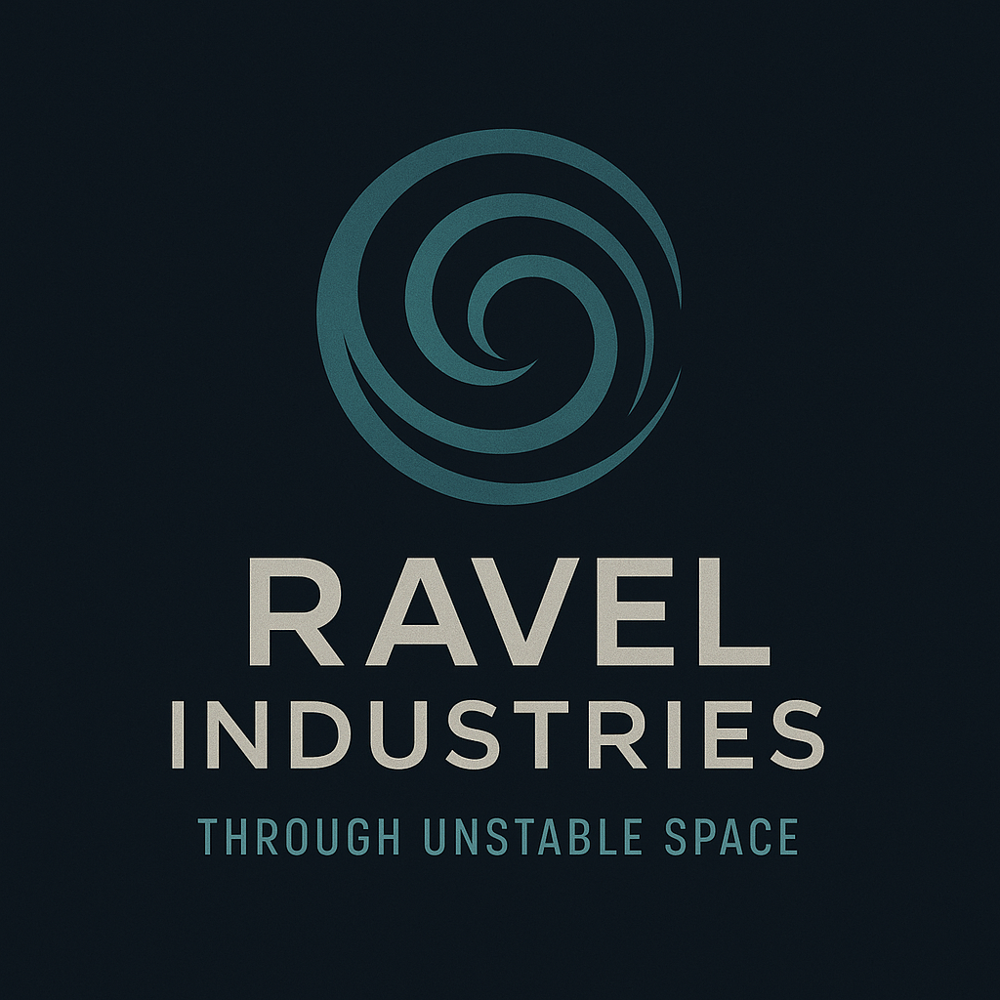

# Ravel Industries

| | |
|---|---|
| **Founded** | 2432 |
| **Headquarters** | Independent research yards scattered across fringe systems, with hidden installations in the Thrennal Expanse |
| **Industry** | Boutique propulsion manufacturer, specializing in high-frequency slip drives |
| **Status** | Independent |

## Overview

Ravel Industries pushes the limits of slipstream technology. While megacorps like Kessler-Orion build mass-market FTL systems, Ravel focuses on specialized high-frequency slip drives for navigating unstable or partially collapsed corridors. Its research has earned both acclaim and suspicion: Ravel drives are infamous for going "where others won't", and their users often walk the line between discovery and disaster.

Ravel thrives on prototype iteration. Its designs are lightweight, adaptive, and tuned for precise control in chaotic flow states. They are also expensive, high-maintenance, and sometimes dangerously untested. Ravel has never secured large government contracts. Its customers are salvage crews, explorers, and fringe operators willing to risk instability for access to otherwise unreachable systems.

## Tone & reputation

- Experimental, fringe, niche
- Risky but visionary; an outsider next to propulsion titans like Kessler-Orion

## Key products

- **HFSD-3A "High-Frequency Slip Drive":** designed and built solely by Ravel. Installed on Quell's Mistral. Built for unstable corridors, with fine-grain harmonic tuning and burst stabilizers. **[settled]**
- **Ravel Harmonizers:** standalone corridor calibration tools, used by captains to "feel" the resonance of degraded flow states
- **Pulse Cascade Regulators:** experimental dampening modules that stabilize power surges near corridor residue
- **EchoFrame Testbeds:** mobile prototype platforms for testing slip drive configurations outside corporate oversight

## Market position

Ravel exists in the shadow of [[kessler-orion-drive-yards]] and [[valdez-systems]], thriving where others fear liability. It is a company for outliers, associated with reckless brilliance. Its products lack mass adoption, but those who fly a Ravel drive reach routes and salvage otherwise deemed impossible. To many, Ravel is the difference between reaching the unreachable and vanishing into unstable space forever.

## Connection to Quell

- Quell spent **17 years** at Ravel as a Senior Systems Engineer in FTL Systems & Harmonic Stability, troubleshooting instability in field-deployed vessels. He took extended leave and never returned. Ravel didn't contest it; his name was quietly dropped from internal systems.
- His Ravel drive is one of the few that can survive the deep Trillium Arc, which is how he reached Dovetail-9.
- A possible career timeline puts him at Ravel when Dovetail-9 vanished in 2467. See [[canon]].

## Reconciliation notes

- The Valdez and Mistral notes credited Valdez with co-developing the HFSD-3A. Canon: **Ravel alone**.
- "HFSD" is used as a general term for high-frequency slip drives. Valdez makes its own HFSD lines; **HFSD-3A** is Ravel's model.

## Open

- **Ravel Prime.** Quell's bio says he was born on Ravel Prime, an industrial planet "governed entirely by Ravel Industries" with domed arcologies and corporate castes. This profile describes a small fringe company with hidden research yards, and Ravel was only three years old when Quell was born there in 2435. Unresolved; see [[canon]].
