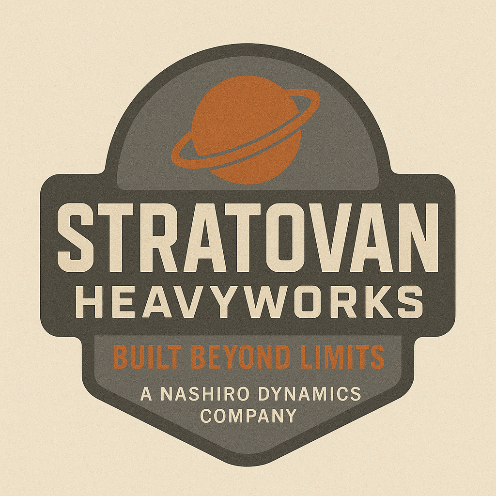

# Stratovan Heavyworks

| | |
|---|---|
| **Founded** | 2412 |
| **Headquarters** | Core frontier nexus, Orion Arm industrial belt |
| **Industry** | Industrial shipbuilding: ISRV-class salvage and retrieval vessels |
| **Saying** | "If it bleeds vacuum, it still runs Stratovan." (common spacer expression, not official) |
| **Status** | Subsidiary of [[nashiro-dynamics]] |

## Overview

A subsidiary of Nashiro Dynamics, Stratovan Heavyworks was established in 2412 to meet growing demand for industrial-grade starships able to operate in unstable frontier zones. While Nashiro stayed focused on macro-scale infrastructure, Stratovan became the workhorse shipwright of the outer rim, known for rugged, modular vessels that balance adaptability with durability.

Its most notable design, the **Mistral-class ISRV**, embodies this ethos: compact enough for solo operation, but engineered for years of salvage and retrieval in hostile FTL zones. The design philosophy emphasizes panoramic visibility, mechanical redundancy, and modular hardpoints for aftermarket systems. Duradyne arms, DYNEX cores, and Blackline electronics are common pairings.

In the 2470s, Stratovan stands as one of the few shipyards trusted equally by independent salvagers, corporate operators, and paramilitary contractors. The Stratovan mark carries a reputation for function over form, and for craft that outlast their operators.

## Tone & reputation

- Rugged, utilitarian, dependable
- Favored by frontier professionals over corporate fleets
- Ships often look weathered, but rarely fail

## Notable products & projects

- **Mistral-class ISRV:** Independent Salvage & Retrieval Vessel. Quell's ship is one.
- Modular hull platforms for FTL corridor survey craft
- Heavy salvage frames compatible with [[duradyne]] robotics
- Longstanding contracts with [[dynex-industries]] (T-Core integration) and [[blackline-systems]] (electronics and comms)

## Ravel Prime **[settled]**

- One of Stratovan's shipbuilding worlds in the Orion Arm industrial belt. Toxic atmosphere from generations of heavy industry; most people live in domed arcologies.
- Run as a company world with **corporate caste tiers**. Children are educated early for technical roles to staff the yards.
- In 2432, a group of its propulsion engineers broke away and founded [[ravel-industries]], named after the world.
- Birthplace of Tobias Quell (2435), who grew up in a mid-tier technical enclave.
- The contrast is deliberate: Stratovan builds ships trusted across the frontier while running a harsh company town.

## Reconciliation notes

- The original note credited Blackline with "navigation & electronics". Navigation belongs to [[stratovan-systems]] (Navien), so Blackline's contract is now **electronics and comms**.

## Open

- Whether Quell's ship is a Mistral-class ISRV named *Mistral*, or has its own name. See [[canon]].
