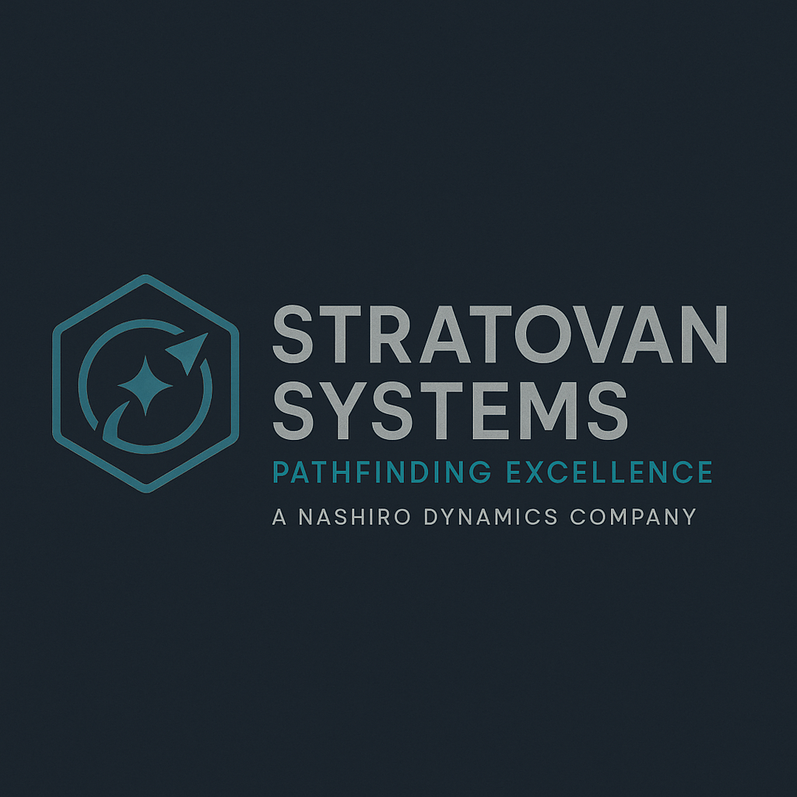

# Stratovan Systems

| | |
|---|---|
| **Founded** | 2437 |
| **Headquarters** | Core system research arcology, Orion Arm |
| **Industry** | Artificial intelligence and navigation systems |
| **Tagline** | "Flow State Navigation." (shared with its flagship product, Navien) |
| **Status** | Subsidiary of [[nashiro-dynamics]] |

## Overview

Created as the technological counterpart to [[stratovan-heavyworks]], Stratovan Systems builds precision AI frameworks, navigation modules, and computational architectures for FTL transit. Where Heavyworks builds the hull, Systems provides the mind and the flow-alignment tools that keep ships moving safely through corridor space.

It is best known for the **Navien AI** platform, first deployed in 2460: a proprietary navigation intelligence that maintains and recalibrates a vessel's flow state in real time. Navien was a leap forward in corridor safety, letting ships traverse unstable or degrading slipstreams where human reaction time would fail.

Stratovan Systems operates under the Nashiro umbrella and has a reputation for sterility, precision, and low error tolerance, prioritizing perfect execution over adaptability. Its tools are not designed for improvisation. They are meant to eliminate it.

## Tone & reputation

- Clinical, exacting, precise
- Trusted for its navigation algorithms, criticized as costly and rigid
- Seen by salvagers as making "calculation tools", not companions

## Notable products & projects

- **Navien AI** (2460): FTL navigation, standard on Mistral-class ISRVs
- **Stratovan NX Flight Management Suite**
- **Corridor harmonics analyzers** for mapping unstable slipstreams
- Multi-tier AI subsystems licensed to corporate fleets

## Role in the Dovetail Program

- **Corridor harmonics analysis.** Stratovan Systems was the Nashiro subsidiary executing the program's harmonic work, alongside outside contractors [[dynex-industries]] and [[valdez-systems]].
- **Not SIGMA's builder.** SIGMA belongs to Nashiro directly.
- **Navien has no role aboard Dovetail-9.** It is ship navigation only.

## Reconciliation notes

- The original Dovetail Experiment note described the station's synchronization AI as "Navien-based". Canon: **SIGMA** runs the station and its harmonic sync. Stratovan's contribution is analysis tools, not the station AI.
