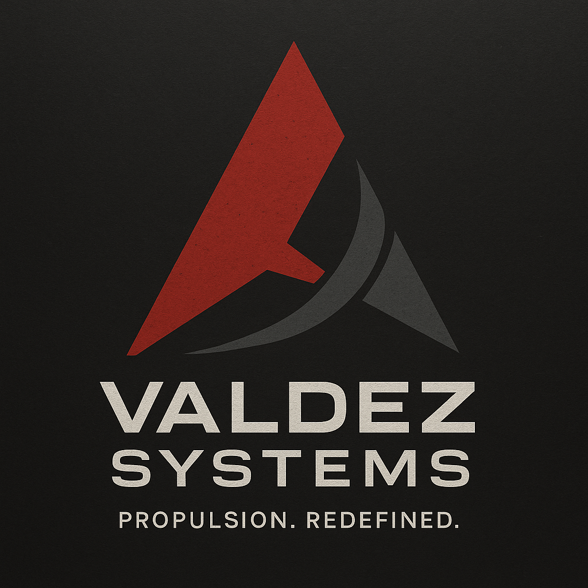

# Valdez Systems

| | |
|---|---|
| **Founded** | 2429 |
| **Headquarters** | Undisclosed frontier R&D facilities, possibly of ex-military origin |
| **Industry** | Advanced propulsion engineering |
| **Tagline** | "Propulsion. Redefined." |
| **Status** | **Independent.** Not a Nashiro subsidiary. **[settled]** |

## Overview

Valdez Systems is a propulsion research and development company with roots in experimental military programs. Unlike mass-market drive manufacturers, Valdez specializes in high-frequency slipstream technology for unstable or degraded FTL corridors. Its products are considered risky but revolutionary, bridging cutting-edge science and dangerous experimentation.

Valdez is a rival to [[ravel-industries]] in high-frequency slipstream technology, with its own HFSD lines. It has built a reputation as a shadowy but indispensable player in frontier expansion, where conventional engines fail.

## Tone & reputation

- Fringe innovator: experimental, sometimes reckless
- Seen as unreliable by major corporations, trusted by independent salvagers and explorers who need drives that survive degraded corridors
- Strongly influenced by ex-military engineers and black-budget projects

## Known products

- **HFSD lines (High-Frequency Slip Drives):** drives able to operate in degraded or unstable corridors
- **Adaptive harmonic stabilizers:** prototypes, rumored to have been used in classified tests

## Role in the Dovetail Program

- **Outside contractor** under Nashiro oversight.
- Supplied the **active harmonic shielding** that protected Dovetail-9's crewed sections: its adaptive harmonic stabilizers. The "classified tests" rumor is the Dovetail Program.
- The shielding was designed against **prolonged** exposure, after Dovetail-5's crew suffered cognitive degradation. It needed constant power, and it dropped for about two seconds during the accident. See [[the-accident]].

## Reconciliation notes

- The original note said Valdez's flagship was the Ravel HFSD-3A, "co-developed with Ravel Industries". Canon: **Ravel built the HFSD-3A alone**. Valdez makes its own HFSD lines.
- The original Experiment note listed Valdez among Nashiro's "subsidiaries". Canon: **independent contractor**.

## Open

- Model names for Valdez's own HFSD lines.
