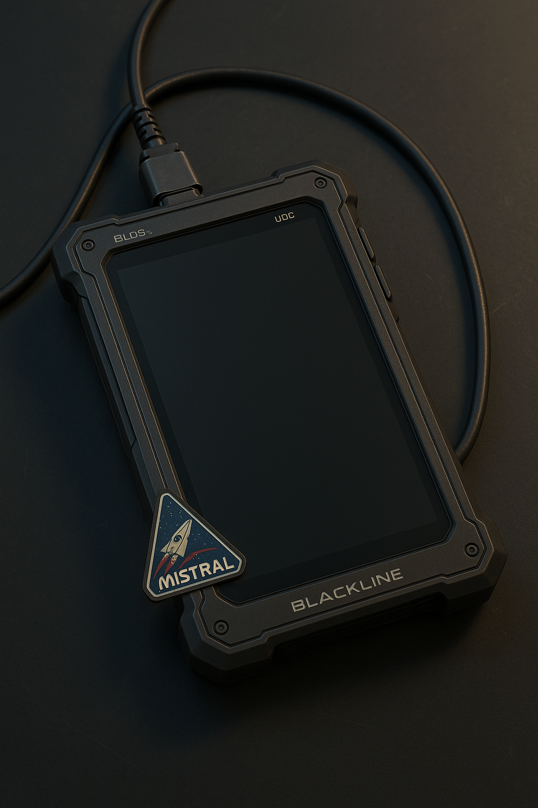

# Blackline Data Slate (BLDS-X)

**[proposed]** Quell's data slate. Name pending; see [[canon]].

| | |
|---|---|
| **Manufacturer** | [[blackline-systems]] ("Through Unstable Space") |
| **Variant** | Salvage-spec, beyond the standard BLDS-1 to BLDS-4H line |
| **Owner** | Tobias Quell |

## Form factor

- **Chassis:** monocarbon self-healing frame with impact-resistant edges
- **Display:** flexible nano-photonic panel for 2D readouts or volumetric "spill" projection
- **Controls:** touch, gesture-field recognition, and haptic ridges for gloved use
- **Weight:** 420 g, balanced for one-handed use in zero-g

## Power

- **Primary:** solid-state microfusion cell, about six months of continuous runtime
- **Backup:** ambient EM harvesting plus emergency solar film
- **Recharge:** inductive cradle in the Mistral's cockpit

## Processing & memory

- **Processor:** Stratovan Q-bit lattice CPU (civilian salvage grade)
- **Memory:** 4.2 PB Quantum-Mem Crystal Core with a Unified Memory Lattice, serving as both storage and working memory. Near-zero latency for AI tethering, salvage scans, and volumetric rendering. Survives vacuum, radiation, and strong magnetic flux.

## Connectivity

- **Universal Data Connector (UDC):** an adaptive hardlink port whose nanopin array conforms to legacy and modern systems. Rated for vacuum, corrosive environments, and high-voltage surges. Used for door overrides, black-box recovery, and reactor diagnostics.
- **Optical Relay Node:** tightbeam photonic link for short-range, line-of-sight bridging. A fast, discreet alternative to open RF.
- **Near-Field Quantum Link (NFQL):** secure low-latency link to the Mistral, up to 1 km.
- **Legacy RF/EM bands:** backward-compatible access to older platforms like Dovetail-9.
- **Protocol Emulation Suite:** spoofs major corporate operating systems (Stratovan, Nashiro, Valdez and others), enabling bypass and command injection.
- **Resonance Override Key (ROK):** a Blackline salvage hack tool built into the UDC. Forces open resonance-locked systems such as sealed bulkheads. High risk of anomalies when overused.

## Security

- Adaptive resonance lock keyed to the user's **bioelectric signature**.
- **AI tether safeguards** for Navien and SIGMA integration.
- Quell keeps his logs behind multiple offline layers. Wireless can be cut by **hardware toggles**, and custom firewalls block anything he hasn't approved. He connects only when he chooses.

## Quirks

An older salvage variant: occasional flickers, corrupted overlays, unstable projections.

## Role in the story

- **Where Quell keeps his daily logs**, in tight technical shorthand.
- **His interface into Dovetail-9:** he hardlinks through the UDC to force doors and run diagnostics.
- **Always at hand on the site:** its own screen comes up over whatever Quell is looking at, in Blackline's look, distinct from SIGMA's. It is not the frame around SIGMA's interface. See [[site-frame]].
- **The site's mechanics come from it:** the Protocol Emulation Suite becomes `spoof` and the ROK becomes `override`. Quell includes both in his data dump so receivers can open SIGMA's locked records.
- **The ROK's anomaly risk** is a possible cause of Quell's memory damage in the archived twist layer.
- **AI tether safeguards** are the hook for a fragment of SIGMA travelling with him, if the archived twist layer is ever revived.
- **The bioelectric lock** would have been a clue in the archived twist layer.

## Reconciliation notes

- **Three names** were in use: BLDS-X (this note), BLDS-4H (the Blackline note), and Solance MX-12 (Quell's bio). Proposal: **BLDS-X**, with 4H as the top standard model. The Keep image shows a Blackline-branded slate marked "BLDS", which supports it.
- Quell's bio described the Solance MX-12's hardware toggles and firewalls. Those details are merged here.

## Open

- Final name. Why a Blackline slate ships with SIGMA tether safeguards (perhaps because SIGMA runs other Nashiro outposts salvagers encounter).
