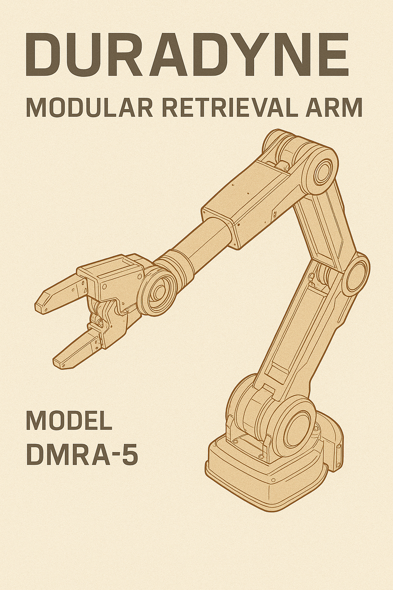

# Duradyne Modular Retrieval Arm (DMRA-5)

| | |
|---|---|
| **Manufacturer** | [[duradyne]] |
| **Model** | DMRA-5 (Duradyne Modular Retrieval Arm, Series 5) |
| **Class** | Industrial-grade shipboard salvage armature |
| **Mount point** | Ventral midship, on a retractable undercarriage gimbal collar |
| **Operator** | Tobias Quell |
| **Function** | Remote salvage, debris extraction, and EVA-assisted manipulation in unstable or hazardous environments |

## Specifications

- **Maximum reach:** 11.2 m fully extended
- **Articulation:** base gimbal collar (270° yaw, 120° pitch), reinforced elbow joint, telescoping forearm, precision multi-tool end effector
- **Materials:** carbon-alloy joint rods, ceramic-composite outer casing, exposed sheathed cabling, secondary shielding welded on after manufacture
- **Weight:** ~1.4 metric tons dry
- **Power:** auxiliary capacitor loop fed from the primary power bus
- **Cooling:** passive vented sheath with emergency spray suppression

## Tooling

| Component | Function |
|---|---|
| **Grapple claw** | Tri-grip with magnetic locks and torque control for secure holds |
| **Plasma cutter** | In the claw's wrist housing, for panel cutting and breach creation |
| **Impact hammer** | Fold-out high-force ram for structural disruption or anchoring |
| **Sensor tether port** | Deploys small visual and audio probes into confined spaces |
| **Manipulator subsystem** | Fine-movement servo array for EVA work and control panel interfacing |
| **Tool hardpoints** | Two modular slots, currently unused |

## Control

- **Primary:** dual haptic sticks with holotactile overlays in the cockpit; live feedback via a wrist-mounted optical suite
- **Backup:** manual override terminal in engineering
- **Autonomy:** none. Fully human-guided, no AI stabilization. Quell refuses automated input.
- **Diagnostics:** error flags cleared by hand; torque alignment done by feel and trial

## Field notes

- Originally part of a Duradyne bulk-freight armature, salvaged and rebuilt by Quell. Serial markings suggest parts from at least three donor units. It replaced the Mistral's stock Duradyne arm.
- The housing bears plasma scoring and repeated impact wear.
- The base joint groans when cold; Quell uses it as a diagnostic cue.
- It occasionally seizes if its capacitors aren't flushed after a jump.

## Reconciliation notes

- The Mistral note called it a "custom Duradyne High-Torque Retrieval Arm". Same arm: canon name is **DMRA-5**.
- The original said "solar-charged capacitors". Simplified to the capacitor loop already named under Power, which runs off the ship's bus.
