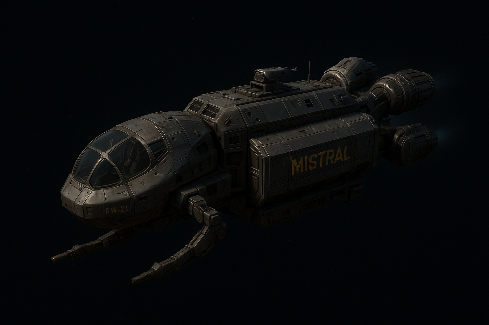

# The Mistral

**Independent Salvage & Retrieval Vessel (ISRV).** Owned and operated by Tobias Quell.

| | |
|---|---|
| **Class** | Mistral-class ISRV |
| **Manufacturer** | [[stratovan-heavyworks]] (subsidiary of Nashiro Dynamics) |
| **Role** | Long-duration salvage in unstable frontier systems (the Trillium Arc, the Thrennal Expanse) |
| **Length / beam / height** | 58 m / 16.5 m / 11.2 m |
| **Mass (unloaded)** | 1,950 metric tons |
| **Crew** | 1 to 3; run solo by Quell |
| **Salvage bay** | 420 m³ |

## Design & feel

Rugged, modular, utilitarian. Not sleek: built like a frontier workhorse. Its **domed forward cockpit** gives it a distinct silhouette and emphasizes exposure and vulnerability.

Lived-in. Weathered, patched, and unmistakably Quell's: tools stowed in odd corners, a mission patch on the hull, small personal touches that set it apart from the production line.

## Core systems

| System | Fitted |
|---|---|
| **Drive** | Ravel **HFSD-3A** high-frequency slip drive ([[ravel-industries]]). Allows risky traversal of degraded corridors. |
| **Power** | [[dynex-t12-core]]. Stable, trusted, built for unstable spacetime. |
| **Salvage** | [[duradyne-dmra-5]] retrieval arm, ventral midship, feeding the salvage bay. Rebuilt by Quell, replacing the stock arm. |
| **Navigation** | [[navien-ai]] (Stratovan Systems). Installed by default; stripped by Quell and treated as a tool, not a companion. |
| **Slate cradle** | Inductive charging cradle for his [[blackline-blds-x]] in the cockpit. |

## Narrative role

- Quell's lifeline and his prison: it carries him into hostile, lawless zones, but its confined spaces underscore his isolation.
- The panoramic cockpit reinforces exposure: he sees everything, and the emptiness stares back.
- His only tether to safety while aboard Dovetail-9. Docking and power routing through the ship are his fallback when the station turns hostile.
- It embodies his independence: high-grade industrial engineering, customized and maintained by him alone.
- Part home, part workshop, part survival pod. One man's entire world between jobs.
- **Escape:** after sending the data dump and triggering the failsafe, the Mistral has to get clear of the ~3.2 km blast radius.

## Reconciliation notes

- The original note credited the drive as "Ravel HFSD-3A (Valdez Systems)". Canon: **Ravel alone** built it.
- The Keep image shows **two** salvage arms. Canon has **one**, the DMRA-5. Treat the image as approximate.
- The image shows the hull marking **"GW-21"**. Not canon yet; could serve as a registry number.

## Open

- Whether *Mistral* is the ship's name, its class, or both. See [[canon]].
