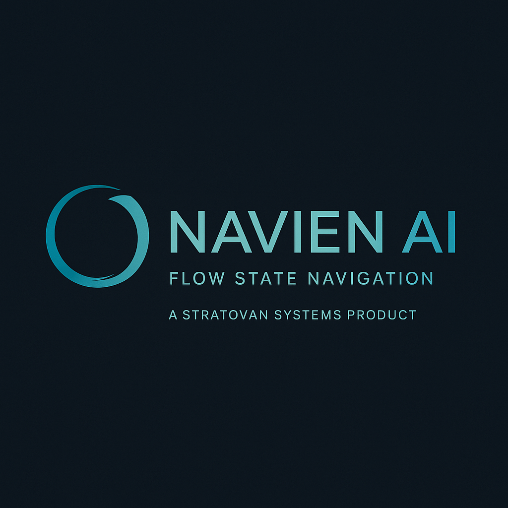

# Navien AI

| | |
|---|---|
| **First released** | 2460 |
| **Developer** | [[stratovan-systems]] (subsidiary of Nashiro Dynamics) |
| **Industry** | Intelligent navigation systems |
| **Tagline** | "Flow State Navigation." |

## Overview

Navien is Stratovan Systems' flagship navigation suite, built for FTL corridor harmonics. Its core job is to calculate and maintain a vessel's **flow state**: the balance of frequency, trajectory, and velocity needed for safe slipstream travel.

Unlike generic navigation systems, Navien combines real-time sensor input with predictive harmonic modeling, so ships can adapt to corridor instabilities as they happen. It is **not sentient**, but its precision and adaptability made it standard on mid- to high-end vessels, including Mistral-class ISRVs.

Pilots consider it indispensable, but rarely think of it as a person. It's a calculation tool, not a companion. Its personality profile is deliberately sterile, reflecting Stratovan's philosophy of minimizing error tolerance and operator "distraction".

## Tone & reputation

- Precision-focused, sterile, uncompromising
- Widely adopted across frontier and corporate fleets
- Clinical, but essential for survival in unstable corridors

## Products

- **Navien AI Suite:** adaptive FTL harmonic navigation software
- **Navien CoreLink:** integration package for third-party ship systems
- **Navien Predictive Harmonic Array:** sensor add-on for unstable corridor operations

## Quell's Navien

- A **modified Navien core node** on the Mistral manages flow state during FTL jumps.
- Quell rewrote most of its non-critical subroutines and stripped its behavioral emulation, leaving only core computation. He lets it handle the most calculation-heavy work and nothing else.
- He relies on it in unstable regions like the Trillium Arc.

## Role in the story

- **Ship navigation only.** Navien has **no role aboard Dovetail-9**. **[settled]**
- A useful contrast with [[sigma]]: both are Nashiro-family AIs, but Navien is a tool kept on a short leash, while SIGMA governs a whole station and became something more.

## Reconciliation notes

- The original Dovetail Experiment note called the station's sync AI "Navien-based". Canon: **SIGMA** runs the station.
