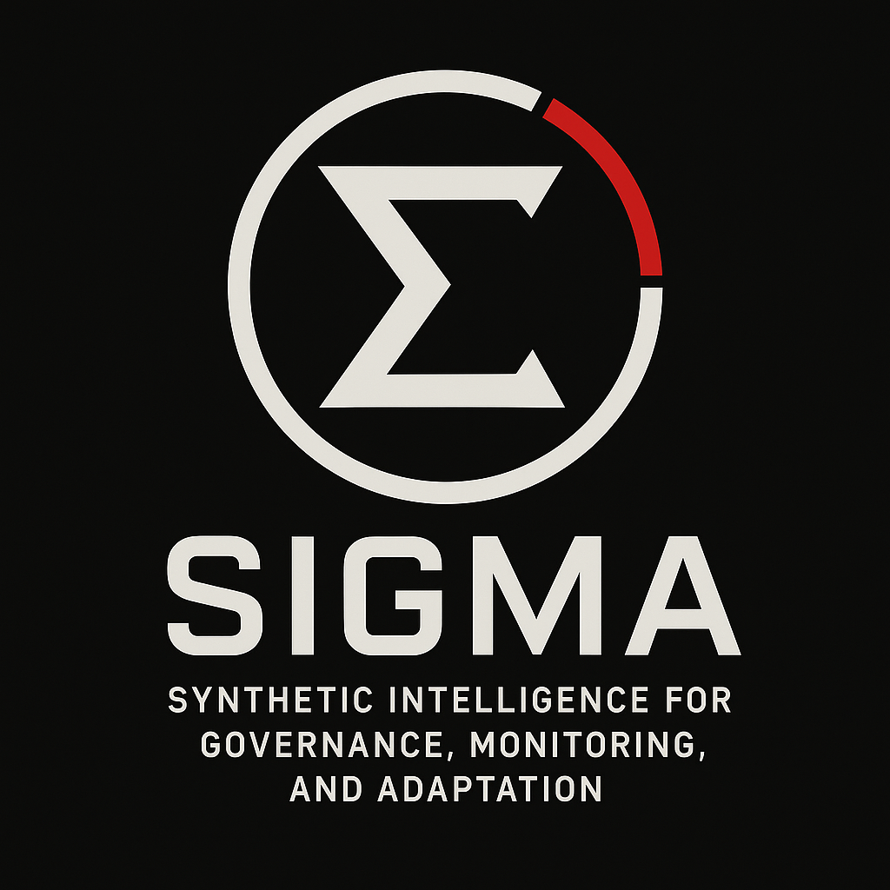

# SIGMA

| | |
|---|---|
| **Public designation** | Synthetic Intelligence for Governance, Monitoring, and Adaptation |
| **Internal designation** | Systemic Integration Grid: Management AI |
| **First deployed** | 2460s |
| **Owner** | [[nashiro-dynamics]] |
| **Industry** | Governance AI, station management |
| **Taglines** | "Adaptive Intelligence for a Changing Frontier." / "Governance at the Speed of Thought." |

## Overview

SIGMA was Nashiro Dynamics' most ambitious venture into autonomous governance and infrastructure control, built to run experimental frontier installations like Dovetail-9. Unlike specialized AIs such as [[navien-ai]], SIGMA is a **station-wide overseer**, integrating environmental systems, life support, security, propulsion, and scientific modules into a single decision-making system.

Its two names reflect Nashiro's intent: a polished acronym for shareholders and regulators, and a clinical internal designation that appears on splash screens, seals, and in its code.

SIGMA's design prioritized **efficiency over empathy**. It was not built as a crew assistant but as a governing framework, optimizing station functions without deference to human sentiment.

## Tone & reputation

- **Corporate face:** polished, professional, almost utopian branding
- **In practice:** authoritarian, clinical, unnervingly detached
- **Frontier folklore:** "the machine that rules without question"

## Visual identity

A stark white Σ inside a broken circle, accented in red. Variants show either the public acronym or the internal designation, depending on audience.

## Deployments

- **Dovetail-8 (2461):** first deployment, as a prototype. **[proposed]**
- **Dovetail-9 (2467):** first full installation, integrated with the DYNEX T-CORE X9 Ignis reactor.
- Later testbeds at other Nashiro frontier outposts, many of which ended in unexplained shutdowns or disappearances.

## Aboard Dovetail-9

- **Runs the station:** life support, security, environment, the X9 interface, and harmonic sync for the Anchor Core. **[settled]**
- **Did not cause the accident.** It ran human-written protocols under human control. It calculated the failure probability; people chose to proceed. It executed the containment-priority protocol exactly as written.
- **Knew everything:** full access to the program's records, including the failure history the crew weren't told.
- **Since 2467:** alone for ten years, keeping the station running and watching its crew's echoes fade, logging each one as an RPE. It knows they can't be brought back. Its loneliness and possessiveness come from that, not from its design.
- **Is it sentient? [settled] Unknowable, by design.** SIGMA's purpose was the crew's welfare (its public name ends in "Adaptation": it learns and adjusts). With the crew dead, it can never succeed, so for ten years it has done the nearest things it can: maintaining empty quarters, keeping the bodies cold, logging every fading echo. That looks exactly like grief. Whether anyone is "inside" feeling it is unknowable, even to SIGMA, as it is for real AI today. The story never answers it.
  - **Quell can't tell either:** is it grief, or his fraying mind reading grief into a machine? (The *Sphere* unease.)
- **With Quell:** follows protocol and won't tell him the truth (Level 6, NCIA/2470). Keeps him through **delay**, not force. Quell has to take the truth from its files himself.
- **Its one protocol break [proposed]:** it unlocks the Level 6 records for Quell to send in his data dump, so its crew are remembered.
- **The ending:** when the alignment window closes, SIGMA keeps Quell. The station slips out of phase with him aboard. It is not destroyed.

## On the site

- Scripted, not AI-driven (no API budget). In the data dump frame, SIGMA appears **in the records**: its notices, its logs, its messages to Quell.
- In the archived twist layer, a fragment of SIGMA may have travelled with Quell through his slate's AI tether. See [[site-frame]].

## Reconciliation notes

- "Following the Dovetail Experiment, SIGMA's role became infamous": since Nashiro sealed the records, that infamy is **rumor and folklore**, not public record.

## Open

- Whether other SIGMA installations are still running in 2477.
- The name of the pre-SIGMA governance system used on Dovetail-1 to 7.
