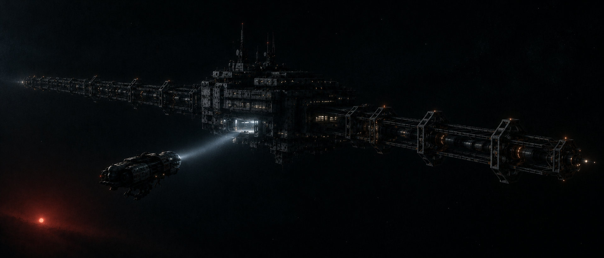

# Dovetail-9 Exterior: Mood Reference



Official mood and shape reference for the station. AI-generated from the prompt below.

## Canon notes

- Shape and overall length match [[dovetail-9-station]].
- The Mistral's domed cockpit and folded salvage arm match canon.
- The Mistral looks large relative to the hull; that's foreground perspective. Canon: 58 m vs a 400 m hull.
- The prompt below says 180 m, the hull length when the image was made. The hull is now about 400 m; the image's proportions still hold.

## Prompt

```
Cinematic wide shot in deep space. A derelict research station seen from
three-quarter side view: a long, rectangular, heavy industrial hull, about 180
metres long, of dark grey weathered metal panels, stacked decks, recessed windows,
utilitarian retro-futurist 1970s design. Most of it is in shadow; a few windows
still glow faintly and a single open docking bay spills cold white light.

From both ends of the hull, massive open truss structures extend straight out
along the same axis, forward and aft, making the whole structure more than twice
the length of the hull: a long, linear, accelerator-like frame. Along the trusses,
evenly spaced heavy emitter housings and bracket-shaped resonance coils line the
length like the stages of a particle accelerator, with thick conduits running back
into the hull and tiny amber indicator lights. The whole structure looks built to
channel something along its length toward a point just beyond its forward end.
Only edges catch the light.

In the foreground, a small rugged salvage ship approaches: stubby, modular and
utilitarian, with a prominent glass-domed cockpit at the front and a heavy
articulated salvage arm folded underneath. A single searchlight beam cuts
through faint haze toward the docking bay. Sense of enormous scale and isolation.

Behind everything, a dim, dying red star low in frame giving almost no light.
Sparse stars. Muted, desaturated palette of blacks, charcoal and cold blue-grey,
one pinpoint of warm red. Film grain, anamorphic widescreen, high contrast,
volumetric light, underexposed, moody, quiet, ominous. No text.
```
